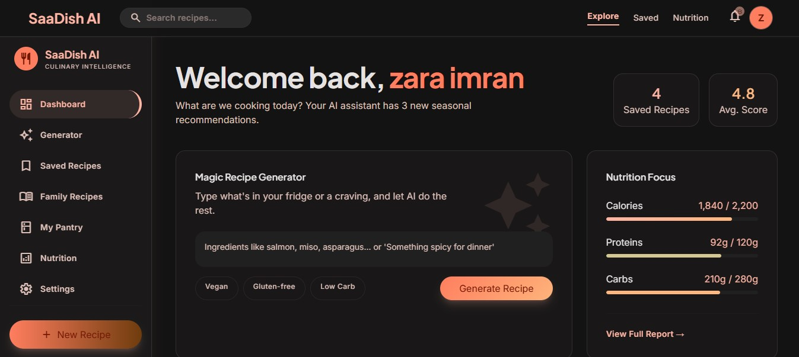

<div align="center">

# 🍳 SaaDish AI — AI-Powered Recipe Generator

**Transform your ingredients into delicious recipes with the power of AI.**

Built with React · Node.js · MongoDB · Groq AI



</div>

---

## ✨ Features

| Category | Details |
|---|---|
| **AI Recipe Generation** | Enter ingredients → get a complete recipe with nutrition, steps, and timers |
| **Strict Pantry Mode** | Restrict recipes to *only* your available ingredients |
| **Smart Substitutions** | Missing an ingredient? Get AI-powered alternatives |
| **Recipe Adaptation** | Make any recipe cheaper, vegetarian, lower-calorie, etc. |
| **Family Recipes** | Preserve and modernize unstructured family recipes |
| **Pantry Manager** | Track ingredients with quantities, units, and expiry dates |
| **Favorites & History** | Save, organize, and revisit your generated recipes |
| **Nutrition Analytics** | Visual breakdowns of calories, protein, carbs, and fat |
| **Cook Mode** | Step-by-step guided cooking with built-in timers |
| **Admin Panel** | Manage users, inspect recipes, and view platform statistics |
| **Email OTP Verification** | Secure signup with 6-digit OTP via EmailJS |
| **Password Recovery** | Forgot-password flow with OTP and hashed reset tokens |

## 🏗️ Tech Stack

| Layer | Technology |
|---|---|
| **Frontend** | React 19, React Router 7, React Hook Form, Vite 8, Tailwind CSS 3 |
| **Backend** | Node.js, Express 5, Mongoose 9, JWT, Zod v4 |
| **Database** | MongoDB Atlas |
| **AI Provider** | Groq SDK (OpenAI-compatible) |
| **Email** | EmailJS (Node.js server SDK) |
| **CI** | GitHub Actions |

## 🚀 Getting Started

### Prerequisites

- **Node.js** ≥ 18
- **MongoDB** (Atlas recommended, or local)
- **Groq API key** — [console.groq.com](https://console.groq.com)
- **EmailJS account** — [emailjs.com](https://www.emailjs.com) (enable non-browser API access)

### 1. Clone & Install

```bash
git clone https://github.com/zaraimran03/ai-recipe-generator-.git
cd ai-recipe-generator-

# Backend
cd backend
cp .env.example .env   # ← fill in your real values
npm install

# Frontend
cd ../frontend
npm install
```

### 2. Configure Environment

Edit `backend/.env` with your actual credentials (see `.env.example` for the required variables):

```env
MONGO_URI=mongodb+srv://...
JWT_SECRET=<random-32+-char-string>
JWT_REFRESH_SECRET=<random-32+-char-string>
GROQ_API_KEY=gsk_...
EMAILJS_PUBLIC_KEY=...
EMAILJS_PRIVATE_KEY=...
EMAILJS_SERVICE_ID=...
EMAILJS_TEMPLATE_ID_VERIFY=...
EMAILJS_TEMPLATE_ID_RESET=...
```

> **⚠️ Important:** The server will refuse to start if `JWT_SECRET`, `JWT_REFRESH_SECRET`, or `MONGO_URI` are missing.

### 3. Run Locally

```bash
# Terminal 1 — Backend (port 8000)
cd backend
npm run dev

# Terminal 2 — Frontend (port 5173)
cd frontend
npm run dev
```

Open [http://localhost:5173](http://localhost:5173) in your browser.

### 4. Create an Admin User

After registering a normal account, promote it to admin in MongoDB:

```js
// In MongoDB shell or Atlas UI
db.users.updateOne(
  { email: "your@email.com" },
  { $set: { role: "admin", is_superuser: true } }
)
```

## 🧪 Testing

```bash
# Backend unit tests (11 tests — validation, auth, security)
cd backend
npm test

# Frontend lint (oxlint)
cd frontend
npm run lint

# Frontend production build
npm run build
```

## 🔒 Security

| Measure | Implementation |
|---|---|
| **No hardcoded secrets** | Server crashes on startup if env vars are missing |
| **Cryptographic OTPs** | `crypto.randomInt()` instead of `Math.random()` |
| **OTP expiration** | 5-minute TTL, max 5 verification attempts, 1-min cooldown |
| **Hashed reset tokens** | SHA-256 hashed before storage |
| **Refresh token rotation** | Old token revoked on each refresh, capped at 5 sessions |
| **Rate limiting** | `express-rate-limit` on login (20/15min), OTP (10/hr) |
| **Input validation** | Zod v4 schemas on all auth endpoints |
| **Data isolation** | Users can only access their own recipes and favorites |
| **Admin RBAC** | Backend middleware checks `role === 'admin'` on every admin route |
| **No sensitive data in responses** | Passwords, OTPs, and API keys are never returned |

## 📁 Project Structure

```
├── backend/
│   ├── controllers/       # Business logic (auth, recipes, etc.)
│   ├── middleware/         # JWT auth, input validation, admin checks
│   ├── models/            # Mongoose schemas (User, Recipe, Pantry, etc.)
│   ├── routes/            # Express route definitions
│   ├── schemas/           # Zod validation schemas
│   ├── services/          # Groq AI, EmailJS integrations
│   ├── tests/             # Jest + Supertest test suites
│   ├── server.js          # App entry point with env validation
│   └── .env.example       # Required environment variables
├── frontend/
│   ├── src/
│   │   ├── components/    # Reusable UI (GlassCard, Button, Toast, etc.)
│   │   ├── context/       # React Context (Auth, Theme)
│   │   ├── pages/         # Route-level pages
│   │   └── services/      # API client modules
│   └── index.html
├── .github/workflows/     # CI pipeline
└── docs/                  # Documentation and images
```

## ⚠️ Known Limitations

- **EmailJS non-browser access** must be manually enabled in the [EmailJS dashboard security settings](https://dashboard.emailjs.com/admin/account/security).
- **AI output validation** for strict pantry mode uses keyword matching; edge cases with ingredient synonyms may pass through.
- **No image generation** — recipe cards use icon placeholders rather than food photos.
- **Single-server architecture** — no horizontal scaling, Redis, or message queues.
- **No email change flow** — users cannot change their registered email address after signup.

## 📄 License

This project is for educational and portfolio purposes.

---

<div align="center">
  <sub>Built with ❤️ by <a href="https://github.com/zaraimran03">Zara Imran</a></sub>
</div>
