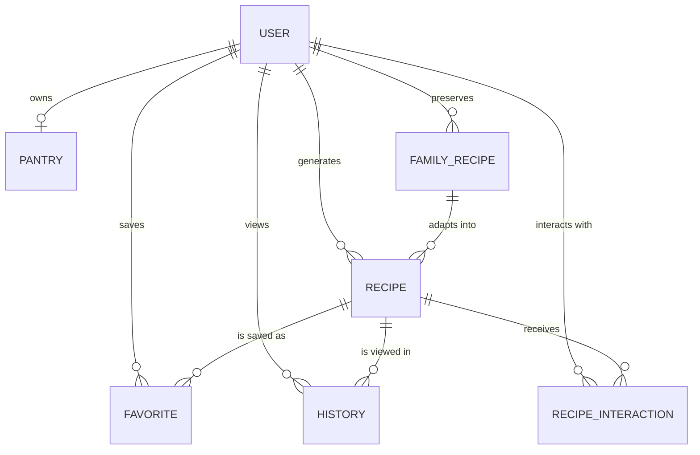

# Database Schema Documentation

This document describes the structure and relationships of the backend database models in MongoDB, managed via Mongoose.

## Entity-Relationship Diagram

## Models

### 1. User
Handles authentication, profile settings, and application preferences.
- **`_id`**: ObjectId, Primary Key.
- **`name`**: String.
- **`email`**: String, Unique, Required. Used for login.
- **`password`**: String, Required. Hashed.
- **`role`**: String, default `'user'`. Use `'admin'` for admin panel access.
- **`diet_preference`**: String, enum (vegetarian, vegan, paleo, keto, gluten_free, none).
- **`generation`**: String, enum (GEN_Z, MILLENNIAL, GEN_X, OLDER_ADULT).
- **`isVerified`**: Boolean, tracks email verification.
- **`refreshTokens`**: Array of Strings, tracks active sessions for token rotation.
- **`otp` / `otpExpires`**: Strings/Dates for secure email OTP verification.

### 2. Recipe
Stores recipes generated by AI or adapted from family recipes.
- **`_id`**: ObjectId, Primary Key.
- **`user`**: ObjectId, ref `User`. Required.
- **`title`**: String.
- **`ingredients`**: Array of Subdocuments (name, quantity, unit, isPantryStaple).
- **`instructions`**: Array of Subdocuments (stepNumber, instruction, timerInMinutes).
- **`nutrition`**: Object (calories, protein, carbs, fat).
- **`metadata`**: Object (servings, difficulty, times, cuisine, dietaryTags).
- **`ingredientHash`**: String, Indexed. Used for caching identical requests.
- **`originalRecipeId`**: ObjectId, ref `Recipe` or `FamilyRecipe`. Tracks lineage for adaptations.

### 3. Pantry
Stores the user's available ingredients for Strict Pantry Mode.
- **`_id`**: ObjectId, Primary Key.
- **`user`**: ObjectId, ref `User`. Required, Unique (One-to-One).
- **`items`**: Array of Subdocuments (name, quantity, unit, expiryDate).

### 4. RecipeInteraction
Tracks user feedback and cooking status for recipes.
- **`_id`**: ObjectId, Primary Key.
- **`userId`**: ObjectId, ref `User`.
- **`recipeId`**: ObjectId, ref `Recipe`.
- **`rating`**: Number (1-5).
- **`liked`**: Boolean.
- **`saved`**: Boolean.
- **`cooked`**: Boolean.
- **`feedback`**: String.

### 5. Favorite & History
Simple associative models tracking user behavior.
- **Favorite**: Links `user` and `recipe` (Unique compound index).
- **History**: Links `user` and `recipe` (creates a log of generated/viewed recipes).

### 6. FamilyRecipe
Preserves unstructured text recipes and maps them to structured data.
- **`_id`**: ObjectId, Primary Key.
- **`userId`**: ObjectId, ref `User`.
- **`originalText`**: String. The raw input from the user.
- **`structuredRecipe`**: Mixed (JSON). The AI-parsed result.
- **`aiAdaptations`**: Array of ObjectIds, ref `Recipe`. Modernized variants generated from this legacy recipe.
